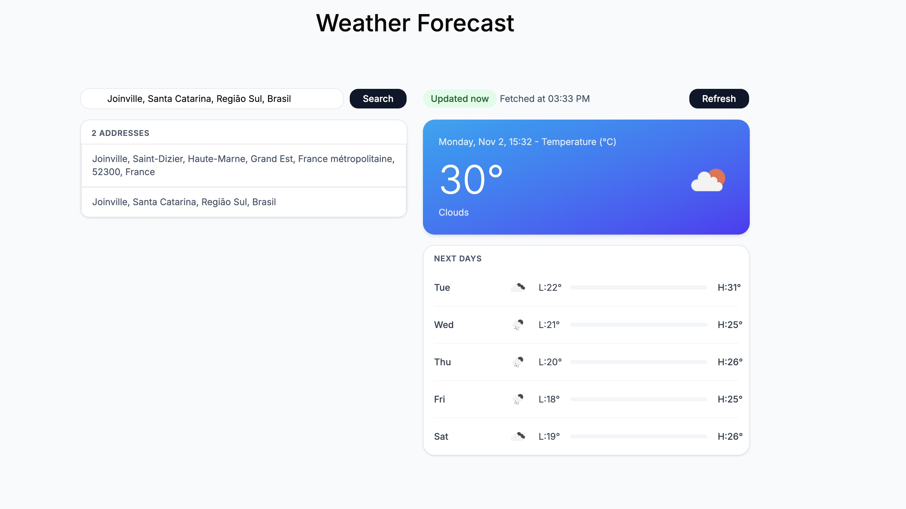

# Weather Forecast

This application search locations based on a given address, and returns the temperature and weather conditions for the specified location.

It consumes data from two distinct APIs:

- [Open Street Maps - OSM](https://www.openstreetmap.org/) for locations and addresses
- [Open Weather](https://openweathermap.org/) for weather conditions

## Project Structure

The app is divided in two layers:

- A backend API written in Ruby on Rails. Check [API docs](apps/api/README.md) for more information
- A frontend written in React. Check [Web docs](apps/web/README.md) for more information

## Overview

https://github.com/user-attachments/assets/168455de-aecb-4dee-856d-affa13b776eb

## General information

### Technical decisions

- **Caching by postcode with 30 minute TTL:** the forecasting from OpenWeather is updated on every 3 hours. A cache in this
  time window follow the requirements and keeps a good balance between fresh data and a lower number of requests.
- **Caching by latitude and longitude with 30 minute TTL:** OpenWeather does not return a valid postcode for some cases. For these cases, where a postcode does not exist, latitude and longitude are used to cache information.
- **Grouping by day in the backend:** the frontend receives data already processed (min/max per day),
  keeping the logic centralized in one place.

### Challenges

- **Timezone as part of the grouping:** the API timestamps come as UTC, which made the forecasts after midnight fall in a day before.
  Than I used the offeset `city.timezone` as part of the time transformation.
- **Forecast incomplete:** because the OpenWeather returns chunks of time for forecast (at least using free quota), the overall calculation is not robust enough. It returns 40 slices (5 days \* 8 chunks), but depending of the time of the request, it will give more or less chunks from the last day, which can mislead to wrong min or max calculations depending how many chunks are there for that day. It also applies for the current day, since the current weather endpoint does not provide these informations directly.

### Known limitations

- The cache mechanism uses `memory_store` in development, so it is lost after restarting the server and it is not shared between processes.

### Future improvements

- Use Redis or Solid Cache to have a persistent cache.
- Add API throttle for both Open Street Maps and OpenWeather to avoid downtime. OSM accepts just a few requests per second,
  but they highly recommend not making more than one. And OpenWeather accepts also 1 request per second.
- Accept a `units` attribute through the API like `units=imperial` to show weather conditions in other units.
- Accept a language attribute through the API like `lang=pt_br` to show the descriptions in other languages. So the frontend
  can determine what language it will be shown.
- A history of recent searches
- The weather condition for each time window, not necessarily only grouped by day. The backend already sends this information,
  it's just a matter of adding another component to render it.
- Add store management for data flow to reduce prop drilling.
- Add FE tests at least for common scenarios
